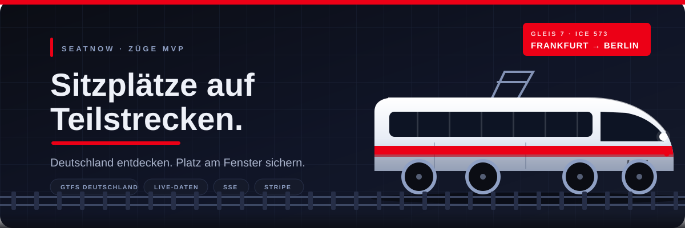
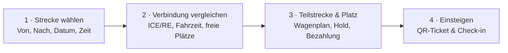
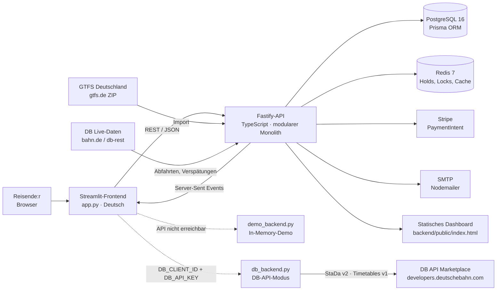
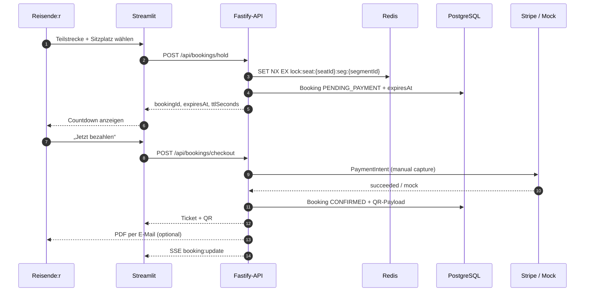
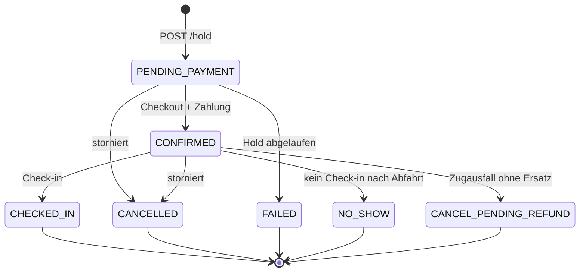

# 🚆 Züge MVP · SeatNow

**Sitzplätze auf Teilstrecken. Live. Fair. Digital.**

<p align="center">
  
</p>

<p align="center">
  
  
  
  
  
  
  
  
</p>

> **Die Idee in einem Satz:** Ein ICE fährt von Frankfurt nach Berlin. Du steigst erst in Fulda ein – warum sollte dich der Abschnitt Frankfurt–Fulda interessieren? **SeatNow denkt in Teilstrecken.** Jeder Sitzplatz wird für genau den Abschnitt reserviert, den du wirklich fährst. So werden Plätze dort frei, wo sie niemand braucht.

> [!IMPORTANT]
> Dies ist ein **unabhängiges Lern- und MVP-Projekt**. Es ist **kein offizielles Angebot der Deutschen Bahn** und steht in keiner Verbindung zur DB AG. Die Live-Daten stammen aus öffentlich zugänglichen DB-Schnittstellen bzw. einem öffentlichen Spiegel. Für echte Fahrkarten bitte `bahn.de` oder die DB Navigator-App nutzen.

---

<a name="inhalt"></a>
## 🗺️ Streckennetz dieser README

| Gleis | Abschnitt | Was dich erwartet |
|:---:|---|---|
| **1** | [Die Idee in 60 Sekunden](#idee) | Warum Teilstrecken das ganze Modell verändern |
| **2** | [Was die App kann](#funktionen) | Alle Funktionen im Überblick |
| **3** | [Deine Reise in vier Schritten](#reise) | Vom Bahnhof bis zum QR-Ticket |
| **4** | [Architektur & Stellwerk](#architektur) | Streamlit, Fastify, PostgreSQL, Redis, SSE |
| **5** | [Schnellstart](#schnellstart) | In 5 Minuten fahren – mit und ohne Backend |
| **6** | [Konfiguration](#konfiguration) | Alle Umgebungsvariablen erklärt |
| **7** | [API-Fahrplan](#api) | Jede Route mit Methode und Zweck |
| **8** | [Buchung & Lebenszyklus](#buchung) | Hold, Zahlung, Check-in, No-Show, Störung |
| **9** | [GTFS & Live-Daten](#daten) | Woher Fahrplan und Verspätungen kommen |
| **10** | [Deployment](#deployment) | Render + Streamlit Cloud |
| **11** | [Projektstruktur](#struktur) | Wo welche Datei liegt |
| **12** | [Tests & Qualität](#tests) | Typecheck, Inventory-Tests, Grenzen |
| **13** | [Grenzen & Roadmap](#grenzen) | Was der MVP bewusst nicht kann |
| **14** | [Glossar](#glossar) | Teilstrecke, Hold, GTFS, EVA & Co. |
| **15** | [FAQ](#faq) | Die häufigsten Fragen aus dem Bordbistro |

---

<a name="idee"></a>
## 🎫 Die Idee in 60 Sekunden

Ein Zug ist keine einzige Strecke, sondern eine **Kette von Halten**:

```text
Frankfurt (Main) Hbf ────── Fulda ────── Kassel-Wilhelmshöhe ────── Berlin Hbf
        [A]                  [B]                 [C]                     [D]
```

Ein Sitzplatz in Wagen 3, Platz 12, kann auf jedem Abschnitt anders belegt sein:

```text
A → B   ████████  gebucht von einer anderen Person
B → C   ░░░░░░░░  frei – genau dein Abschnitt
C → D   ████████  gebucht von jemand anderem
```

Klassische Sitzplatzsysteme sperren den Platz für die **gesamte** Fahrt. SeatNow verwaltet ihn **pro Teilstrecke**:

- Ein Platz kann auf `A → B` belegt und auf `B → C` frei sein.
- Zwei Buchungen dürfen sich **nicht überschneiden** – auch nicht teilweise.
- Beim Einsteigen in Fulda ist der Platz also frei, obwohl er ab Frankfurt gebucht war.
- Wird ein Platz nicht gebraucht, kann ihn jemand anderes für seinen Abschnitt buchen.

Das macht das Angebot flexibler, gerechter und näher an der Realität im Fernverkehr. Technisch steckt dahinter eine **Intervall-Logik über Stop-Sequenzen**: Zwei Buchungen kollidieren genau dann, wenn sich ihre Abschnitte überschneiden.

```text
Buchung A:  Sequenz 0 → 2   (Frankfurt → Kassel)
Buchung B:  Sequenz 2 → 4   (Kassel → Berlin)     ✅ kein Konflikt
Buchung C:  Sequenz 1 → 3   (Fulda → Berlin)      ❌ Konflikt mit A und B
```

Die App ist damit gleichzeitig:

- **Reiseauskunft** für deutsche Fernverkehrsverbindungen,
- **Sitzplatzbuchung** mit Wagenplan und Live-Belegung,
- **Lehrstück** für verteilte Systeme mit Redis-Locks, TTLs, SSE und PostgreSQL,
- **spielbare Demo**, die auch ohne Backend und ohne Internet-Verträge funktioniert.

---

<a name="funktionen"></a>
## ✨ Was die App kann

### 🎫 Reisesuche wie eine Abfahrtstafel

- **Bahnhofssuche mit Vorschlägen** ab zwei Buchstaben – inklusive Fuzzy-Treffern und Aliassen wie `Munich`, `Koeln`, `Cologne` oder `Freiburg im Breisgau`.
- **GPS-Startbahnhof:** Ein kleiner Streamlit-Custom-Component fragt den Browser-Standort ab und findet den nächsten Bahnhof mit Koordinaten.
- **Datum, Uhrzeit und Zeitfenster:** Suche nach Abfahrt oder Ankunft, „von“ und optional „bis“.
- **Schnellstart-Beispiele:** Ein Klick auf `Fulda → Frankfurt Hbf`, `Frankfurt Hbf → Berlin Hbf` oder `Köln Hbf → München Hbf`.
- **Verbindungskarten** mit Zuglabel (`ICE 573`, `RE 50`, …), Abfahrt, Ankunft, Fahrzeit und freien Plätzen.
- **Ampel für freie Plätze:** grün = viele frei, orange = wenige, rot = ausgebucht.
- **Suchen ohne Konto.** Erst beim Reservieren wird eine Anmeldung benötigt.
- **Zugnummern werden nachgeladen**, wenn der Live-Dienst sie noch nicht kennt – mit „Ergebnisse aktualisieren“.
- **Zeitzone Europe/Berlin** und GTFS-Zeiten über 24:00 Uhr (z. B. `25:10` = 01:10 am Folgetag) werden korrekt dargestellt.
- **Klare Navigation:** sichtbar sind nur **Suche** und **Buchungen**. Die Fahrt-Ansicht öffnet sich erst über „Sitzplatz wählen“ – sie ist kein eigener Navigationspunkt.
- **5-Minuten-Fenster auf der Fahrt:** Rechts neben dem Zugkopf läuft ein Countdown zum Reservieren. Ab der letzten Minute wird er rot; ohne Reservierung schließt sich die Fahrt automatisch und die Auswahl wird verworfen.

### 🪑 Wagenplan & Reservierung

- **Teilstrecke wählen:** Jede Verbindung wird in Abschnitte zerlegt. Preis, Dauer und Distanz stehen direkt in der Auswahl.
- **Visueller Wagenplan:** zwei Wagen mit je 25 Sitzen, farbig nach Status:
  - 🟢 **frei** in diesem Abschnitt,
  - 🟠 **gerade reserviert** (Hold läuft),
  - 🔴 **gebucht**.
- **Tooltips** zeigen, welche anderen Abschnitte desselben Sitzes belegt sind.
- **Sitzplatz antippen** und mit einem Klick reservieren.
- **Hold mit Countdown:** Der Platz wird für 5 Minuten gesperrt. Ein Streamlit-Fragment aktualisiert den Countdown **jede Sekunde**; ist die Zeit abgelaufen, wird der Platz freigegeben.
- **Live-Aktualisierung** des Wagenplans alle 30 Sekunden, Availability-Cache nur 5 Sekunden.
- **Demo-Kauf** eines anderen Passagiers (nur im Entwicklungsmodus), um die Live-Aktualisierung sofort zu sehen.

### 💳 Zahlung, Ticket & E-Mail

- **Stripe PaymentIntent mit manueller Erfassung** (`capture_method = manual`), wenn ein Stripe-Key konfiguriert ist.
- **Mock-Zahlung**, wenn kein Stripe-Key vorhanden ist – ideal für lokale Entwicklung.
- **QR-Boarding-Pass** im Format `TKT-…` direkt nach der Zahlung.
- **PDF-Ticket** mit PDFKit, per Nodemailer an die hinterlegte E-Mail-Adresse (optional, wenn SMTP konfiguriert ist).
- **Bestätigungsseite** mit Sitzplatz, Betrag, Status und Zahlungsart.
- **Stornierung** gibt den Platz sofort wieder frei.

### 📡 Echtzeit-Daten der Deutschen Bahn

- **Verspätung, Gleis, Ausfall, tatsächliche Abfahrt/Ankunft, nächste Halte und Position** – sofern der Live-Dienst die Daten liefert.
- **Zwei Provider:**
  - `bahn-web` – Abfahrten über die DB-Webschnittstelle,
  - `db-rest` – öffentlicher Spiegel `v6/v5.db.transport.rest`,
  - `off` – nur GTFS-Fahrplan, keine Live-Daten.
- **Panel aktualisiert sich alle 60 Sekunden**, der Server pollt standardmäßig alle 20 Sekunden.
- **Zugnummern** werden aus dem Live-Board abgeleitet und den GTFS-Fahrten zugeordnet.
- **SSE-Kanal** `/api/trains/:tripId/live` für Sitzplatzänderungen, Buchungsstatus und Serverzeit.

### 🎟️ Meine Buchungen & Check-in

- **Alle Buchungen** mit Zug, Teilstrecke, Wagen, Platz, Betrag, Status und Erstellungszeit.
- **Status-Badges** auf Deutsch: Bestätigt, Zahlung offen, Eingecheckt, Nicht erschienen, Storniert, Fehlgeschlagen.
- **QR-Ticket** jederzeit aufklappbar.
- **Digitaler Check-in** per Button oder QR-Prüfung.
- **No-Show-Regel:** Wer nach der Abfahrt am Einstiegsbahnhof nicht eincheckt, dessen Platz wird nach einer Kulanzzeit für die restlichen Abschnitte freigegeben.
- **Stornieren** gibt den Platz sofort wieder frei – in der App für Buchungen mit Status „Zahlung offen“ oder „Bestätigt“.

### 🛠️ Störungen & Betrieb

- **Kritische Verspätung** (Standard: ≥ 60 Minuten) löst eine proaktive Benachrichtigung aus.
- **Zugausfall:** Das System sucht automatisch eine Ersatzverbindung am selben Tag. Klappt das, wird umgebucht und ein neues QR-Ticket erzeugt. Sonst landet die Buchung in `CANCEL_PENDING_REFUND`.
- **Deduplizierung** über Redis: dieselbe Störung wird sechs Stunden lang nicht erneut verarbeitet.

### 🧪 Demo-Modus – die App fährt auch ohne Backend

- Ist die API nicht erreichbar, schaltet die App automatisch auf `demo://seatnow` um.
- `demo_backend.py` simuliert Suche, Buchung, Check-in, Storno und Live-Panel **im Arbeitsspeicher**.
- Ideal für Streamlit Cloud, Vorführungen und Entwicklung ohne PostgreSQL/Redis.
- Ein oranges Badge **Demo-Modus** zeigt ehrlich an: Hier fahren Beispieldaten.
- Der Button **Backend verbinden** prüft die konfigurierte API erneut.

### 🗄️ DB-API-Modus – echte Fahrpläne ohne eigenes Backend

Mit Zugangsdaten aus dem [DB API Marketplace](https://developers.deutschebahn.com/) holt die App echte Bahnhöfe und Fahrpläne direkt in den Streamlit-Prozess:

- **`db_backend.py`** bildet dieselbe `handle()`-Schnittstelle wie `demo_backend.py` ab.
- **StaDa v2** liefert den Bahnhofskatalog. Er liegt einmalig heruntergeladen in `data/db_stations.json` (5.408 Bahnhöfe) und wird für Vorschläge und GPS genutzt.
- **Timetables v1** liefert den Soll-Fahrplan je Bahnhof und Stunde; daraus entstehen echte Zugnummern, Abfahrten und Ankünfte.
- Ein grünes Badge **DB Live** zeigt den Modus an.
- **Nur Direktverbindungen:** Die API liefert keine Umstiegsrouting – die App sucht Züge, die Start und Ziel ohne Umstieg bedienen.
- **Fahrplanhorizont ~24 Stunden:** Mehr als heute und morgen liefert die API nicht; der Datumswähler ist entsprechend begrenzt.
- **Sitze, Preise und Buchungen bleiben simuliert**, weil die DB API weder Sitzplatzverfügbarkeit noch Tarife veröffentlicht. Login, Hold, Checkout und Check-in laufen unverändert über `demo_backend.py`.

Voraussetzung sind zwei Streamlit-Secrets (oder Umgebungsvariablen):

```toml
DB_CLIENT_ID = "deine-client-id"
DB_API_KEY = "dein-api-key"
```

Priorität: `API_BASE_URL` (eigenes Backend) → DB-API-Modus → Demo-Modus. Mit `SEATNOW_DEMO=1` lässt sich der Demo-Modus erzwingen.

Den Bahnhofskatalog aktualisierst du bei Bedarf neu:

```powershell
$env:DB_CLIENT_ID = "…"
$env:DB_API_KEY = "…"
python tools/fetch_db_stations.py
```

---

<a name="reise"></a>
## 🧭 Deine Reise in vier Schritten



### Schritt 1 · Strecke wählen

Start und Ziel eintippen – Vorschläge erscheinen automatisch. Der Startbahnhof kann per GPS gefüllt werden. Datum und Uhrzeit sind bereits auf „jetzt“ gesetzt.

### Schritt 2 · Verbindung vergleichen

Die Ergebnisliste zeigt dir:

- Zugtyp und Zugnummer,
- Abfahrt und Ankunft,
- Fahrzeit,
- freie Plätze auf deiner Teilstrecke.

Grün bedeutet: viele Plätze frei. Orange: nur wenige. Rot: ausgebucht.

### Schritt 3 · Teilstrecke & Platz sichern

1. Teilstrecke auswählen (z. B. `Fulda → Berlin Hbf`).
2. Freien Platz im Wagenplan antippen.
3. **Sitzplatz reservieren** – der Platz wird für die Hold-Dauer gesperrt.
4. Innerhalb des Countdowns bezahlen.
5. Danach erscheint dein **QR-Boarding-Pass**.

### Schritt 4 · Einsteigen

Zeige den QR-Code beim Einstieg oder nutze den Check-in unter **Meine Buchungen**. Nach erfolgreichem Check-in bleibt der Platz bis zum Ziel reserviert.

---

<a name="architektur"></a>
## 🏗️ Architektur & Stellwerk



### Die wichtigsten Bausteine

| Baustein | Rolle im System | Bahn-Metapher |
|---|---|---|
| **Streamlit** (`app.py`) | Deutsche Benutzeroberfläche, Suche, Wagenplan, Buchungen | Fahrkartenschalter & Bahnsteiganzeige |
| **Fastify + TypeScript** | REST-API, Validierung, Auth, Buchungslogik | Stellwerk |
| **PostgreSQL + Prisma** | Nutzer, Fahrten, Halte, Segmente, Sitze, Buchungen | Fahrplanarchiv |
| **Redis** | Hold-Locks pro `(Sitz, Teilstrecke)`, Cache, TTL-Events, Störungs-Dedupe | Sperrsignal |
| **GTFS-Import** | Fahrplan aus dem Deutschland-Feed | Streckenplan |
| **Live-Provider** | Verspätungen und Gleise von DB-Schnittstellen | Zugfunk |
| **SSE-Broker** | Echtzeit-Updates an offene Wagenpläne | Durchsagen am Bahnsteig |
| **Stripe / Mock** | Zahlung und Reservierungsbestätigung | Fahrkartenautomat |
| **Nodemailer + PDFKit** | Ticket als PDF per E-Mail | Bordkarte zum Mitnehmen |

### Der Weg einer Reservierung



### Warum Redis?

Redis ist hier kein Cache-Anhängsel, sondern Teil der Korrektheit:

- **Atomarer Lock:** `SET key value EX ttl NX` sorgt dafür, dass bei parallelen Klicks genau eine Person den Platz bekommt.
- **TTL statt Timer:** Läuft der Hold ab, verschwindet der Key automatisch.
- **Keyspace-Events:** Redis meldet abgelaufene Keys (`Ex`), das Backend gibt den Sitz frei und schickt ein SSE-Event.
- **Lua-Skripte:** Locks werden nur freigegeben, wenn sie wirklich zur eigenen Buchung gehören.
- **Deduplizierung:** Störungen werden pro Fahrt und Art sechs Stunden lang nicht doppelt verarbeitet.

### Warum zusätzlich die Datenbank prüft

Der Redis-Lock schützt den **exakten** Abschnitt. Zwei verschiedene, aber **überlappende** Abschnitte (`Fulda → Berlin` und `Frankfurt → Kassel`) haben unterschiedliche Keys. Deshalb prüft das Backend zusätzlich in PostgreSQL, ob es eine aktive Buchung mit überschneidender Stop-Sequenz gibt. Erst dann wird die Buchung angelegt.

---

<a name="schnellstart"></a>
## 🚀 Schnellstart

### Variante A · Nur Frontend (Demo-Modus, 2 Minuten)

Du brauchst nur Python. Ohne Backend startet die App automatisch im Demo-Modus.

```powershell
python -m venv .venv
.\.venv\Scripts\Activate.ps1
pip install -r requirements.txt
streamlit run app.py
```

Unter macOS/Linux:

```bash
python3 -m venv .venv
source .venv/bin/activate
pip install -r requirements.txt
streamlit run app.py
```

Dann öffnest du <http://localhost:8501>. Oben rechts findest du die vorausgefüllte Demo-Anmeldung:

| Rolle | E-Mail | Passwort |
|---|---|---|
| Demo-Passagier | `demo@trenes.local` | `demo1234` |
| Demo-Admin (nur Demo-Backend) | `admin@trenes.local` | `admin1234` |

> [!TIP]
> Der Button **Demo-Anmeldung** füllt die Zugangsdaten aus. Der Demo-Modus wird **nicht** dadurch aktiviert, sondern nur dann, wenn die API nicht erreichbar ist. Mit `SEATNOW_DEMO=1` kannst du ihn erzwingen.

### Variante A2 · Echte DB-Fahrpläne ohne Backend (DB-API-Modus)

Wenn du Zugangsdaten aus dem DB API Marketplace hast, brauchst du weder Render noch Docker:

```powershell
# 1. Secrets für Streamlit anlegen
New-Item -ItemType Directory -Force .streamlit | Out-Null
@"
DB_CLIENT_ID = "deine-client-id"
DB_API_KEY = "dein-api-key"
"@ | Set-Content .streamlit/secrets.toml

# 2. App starten
streamlit run app.py
```

Unter macOS/Linux genauso, nur mit `export DB_CLIENT_ID=…` und `export DB_API_KEY=…`.
Oben erscheint dann das grüne Badge **DB Live**, und die Suche liefert echte Zugnummern und Zeiten.

> [!IMPORTANT]
> `.streamlit/secrets.toml` ist in `.gitignore`. Committe diese Datei nie.
> Der Datumswähler ist im DB-API-Modus auf heute und morgen begrenzt, weil die
> Timetables-API nur etwa 24 Stunden im Voraus liefert.

### Variante B · Kompletter Stack (echte API, PostgreSQL, Redis)

**Voraussetzungen:** Python 3.11+, Node.js 20+, Docker Desktop.

```powershell
# 1. Infrastruktur starten (PostgreSQL auf 5433, Redis auf 6379)
Copy-Item .env.example .env
docker compose up -d

# 2. Backend-Abhängigkeiten und Datenbank
Copy-Item backend\.env.example backend\.env
npm --prefix backend install
npm --prefix backend run db:generate
npm --prefix backend run db:push

# 3. Admin anlegen (Passwort nach Wunsch)
$env:ADMIN_PASSWORD = "admin1234"
npm --prefix backend run seed:admin

# 4. Fahrplan importieren
npm --prefix backend run gtfs:ingest

# 5. API starten (Terminal offen lassen)
npm --prefix backend run dev
```

In einem **zweiten Terminal** startest du das Frontend:

```powershell
$env:API_BASE_URL = "http://localhost:3000"
streamlit run app.py
```

Unter macOS/Linux entsprechend:

```bash
export API_BASE_URL=http://localhost:3000
streamlit run app.py
```

Prüfe die API:

```powershell
Invoke-RestMethod http://localhost:3000/health
Invoke-RestMethod http://localhost:3000/api/trains/stats
```

`/health` liefert `status`, `payments` und `mail`. `/api/trains/stats` zeigt die Anzahl der Fahrten, Teilstrecken und Sitze sowie den letzten GTFS-Import.

> [!WARNING]
> Das mitgelieferte `backend/gtfs-data/` ist nur ein **Mini-Beispiel** mit spanischen AVE-Bahnhöfen (Madrid, Barcelona, …) für Smoke-Tests. Für deutsche Züge musst du den Deutschland-Feed importieren:
>
> ```powershell
> $env:GTFS_URL = "https://download.gtfs.de/germany/fv_free/latest.zip"
> npm --prefix backend run gtfs:ingest
> ```
>
> Der vollständige Import dauert etwa 2–3 Minuten und erzeugt rund **5.400 Fahrten**. Danach findest du ICE/RE-Verbindungen wie `Fulda → Frankfurt Hbf`.

### Variante C · Statisches Dashboard der API

Der Fastify-Server liefert unter <http://localhost:3000/> eine eigenständige Single-File-Weboberfläche aus (`backend/public/index.html`). Sie nutzt dieselbe API und denselben SSE-Kanal – praktisch, um das Backend ohne Streamlit zu testen.

---

<a name="konfiguration"></a>
## ⚙️ Konfiguration

### Frontend (Streamlit)

| Variable | Wo? | Bedeutung |
|---|---|---|
| `API_BASE_URL` | Umgebung (`$env:` / `export`) oder Streamlit-Secret | URL der Fastify-API, z. B. `http://localhost:3000` |
| `DB_CLIENT_ID` | Streamlit-Secret oder Umgebung | Client-ID aus dem DB API Marketplace (aktiviert den DB-API-Modus) |
| `DB_API_KEY` | Streamlit-Secret oder Umgebung | API-Key aus dem DB API Marketplace |
| `DB_MARKETPLACE_URL` | Optional | Andere Basis-URL der Marketplace-API |
| `SEATNOW_DEMO` | Umgebung | `1` erzwingt den Demo-Modus, auch wenn die API läuft |

Für Streamlit Cloud legst du die Werte unter **Settings → Secrets** ab. Entweder die eigene API:

```toml
API_BASE_URL = "https://deine-api.onrender.com"
```

oder direkt die DB API (kein eigenes Backend nötig):

```toml
DB_CLIENT_ID = "deine-client-id"
DB_API_KEY = "dein-api-key"
```

> [!WARNING]
> Secrets gehören **nicht** ins Repository. Wenn ein Key versehentlich geteilt wurde, rotiere ihn im DB API Marketplace.

### Backend – Kern

| Variable | Standard | Bedeutung |
|---|---|---|
| `NODE_ENV` | `development` | `development`, `test` oder `production` |
| `PORT` | `3000` | Port der API |
| `FRONTEND_URL` | `http://localhost:19006` | Erlaubte CORS-Origin in Produktion |
| `DATABASE_URL` | – | PostgreSQL-Verbindung (Pflicht) |
| `REDIS_URL` | – | Redis-Verbindung (Pflicht für Holds) |
| `JWT_SECRET` | – | Signatur-Secret, mindestens 8 Zeichen |
| `JWT_EXPIRES_IN` | `7d` | Gültigkeit des Tokens |
| `SEAT_HOLD_TTL_SECONDS` | `300` | Hold-Dauer; im Deployment `600` |
| `INVENTORY_PROVIDER` | `simulated` | `simulated` (MVP) oder `db` (Stub) |

### Backend – Live-Daten & Regeln

| Variable | Standard | Bedeutung |
|---|---|---|
| `REALTIME_PROVIDER` | `bahn-web` | `bahn-web`, `db-rest` oder `off` |
| `REALTIME_DB_REST_URL` | leer | Optionaler eigener Spiegel |
| `REALTIME_POLL_MS` | `20000` | Poll-Intervall, Minimum 10 s |
| `REALTIME_FULDA_EVA` | `8000115` | EVA-Code der Referenzstation (Fulda) |
| `CRITICAL_DELAY_MINUTES` | `60` | Schwelle für proaktive Störungsmeldung |
| `NO_SHOW_GRACE_MINUTES` | `15` | Kulanzzeit nach Abfahrt ohne Check-in |
| `NO_SHOW_SWEEP_MS` | `60000` | Intervall des No-Show-Sweeps |

### Backend – Zahlung, E-Mail & GTFS

| Variable | Standard | Bedeutung |
|---|---|---|
| `STRIPE_SECRET_KEY` | leer | Leer = Mock-Zahlung |
| `STRIPE_PUBLISHABLE_KEY` | leer | Optional für echte Clients |
| `STRIPE_WEBHOOK_SECRET` | leer | Für Webhook-Verarbeitung |
| `SMTP_HOST` / `SMTP_PORT` | `smtp.mailtrap.io` / `587` | Mailserver |
| `SMTP_USER` / `SMTP_PASS` | leer | Leer = E-Mail-Versand deaktiviert |
| `MAIL_FROM` | `Trenes MVP <…>` | Absender |
| `GTFS_SOURCE` | `./gtfs-data` | Lokaler Ordner oder ZIP |
| `GTFS_URL` | leer | Öffentliche ZIP-URL, hat Vorrang |
| `GTFS_FILTER_STOPS` | leer | Kommagetrennte Bahnhofsfilter |
| `ADMIN_EMAIL` / `ADMIN_PASSWORD` | `admin@trenes.local` / `admin1234` | Seed des Admin-Kontos |
| `DEMO_EMAIL` / `DEMO_PASSWORD` | `demo@trenes.local` / `demo1234` | Seed des Demo-Kontos |
| `UPLOAD_DIR` | `./uploads` | Ablage für Uploads |
| `PUBLIC_BASE_URL` | `http://localhost:3000` | Öffentliche API-Basis |

> [!NOTE]
> Die Backend-Konfiguration wird beim Start mit **Zod** validiert. Fehlt `DATABASE_URL`, `REDIS_URL` oder ein ausreichend langes `JWT_SECRET`, beendet sich der Prozess mit einer klaren Fehlermeldung. Die vollständigen Beispiele stehen in `.env.example` und `backend/.env.example`.

---

<a name="api"></a>
## 📡 API-Fahrplan

Basis-URL lokal: `http://localhost:3000`  
Auth: `Authorization: Bearer <JWT>`  
Legende: 🔓 öffentlich · 🔒 angemeldet · 👑 Admin · 📡 SSE-Stream

### System & Fahrplan

| Methode | Route | Auth | Zweck |
|---|---|:---:|---|
| `GET` | `/health` | 🔓 | Status, Zahlungsmodus, Mailmodus |
| `GET` | `/api/trains/search` | 🔓 | Verbindungen suchen (`origin`, `destination`, `date`, `timeType`, `timeFrom`, `timeTo`, `limit`) |
| `GET` | `/api/trains/stops?q=…` | 🔓 | Bahnhofsvorschläge |
| `GET` | `/api/trains/stops/nearby?lat=…&lon=…` | 🔓 | Nächster Bahnhof zu Koordinaten |
| `GET` | `/api/trains/stats` | 🔓 | Anzahl Fahrten, Segmente, Sitze, letzter Import |
| `GET` | `/api/trains/numbers?date=…` | 🔓 | Zugnummern des Tages |
| `GET` | `/api/trains/:tripId` | 🔓 | Fahrtdetails inkl. Halte und Segmente |
| `GET` | `/api/trains/:tripId/segments` | 🔓 | Teilstrecken der Fahrt |
| `GET` | `/api/trains/:tripId/seats` | 🔓 | Sitze der Fahrt |
| `GET` | `/api/trains/:tripId/segments/:segmentId/availability` | 🔓 | Wagenplan pro Teilstrecke |
| `GET` | `/api/trains/:tripId/realtime` | 🔓 | Live-Daten: Verspätung, Gleis, Ausfall, Position |
| `GET` | `/api/trains/:tripId/live` | 📡 | SSE: `hello`, `seat:update`, `booking:update`, `server:time` |

### Authentifizierung

| Methode | Route | Auth | Zweck |
|---|---|:---:|---|
| `POST` | `/api/auth/register` | 🔓 | Konto erstellen, liefert JWT |
| `POST` | `/api/auth/login` | 🔓 | Anmelden, liefert JWT |
| `GET` | `/api/auth/me` | 🔒 | Eigenes Profil |

### Buchungen

| Methode | Route | Auth | Zweck |
|---|---|:---:|---|
| `POST` | `/api/bookings/hold` | 🔒 | Sitzplatz auf Teilstrecke sperren |
| `POST` | `/api/bookings/checkout` | 🔒 | Hold bezahlen und bestätigen |
| `GET` | `/api/bookings` | 🔒 | Eigene Buchungen |
| `GET` | `/api/bookings/:id` | 🔒 | Eine Buchung |
| `POST` | `/api/bookings/:id/cancel` | 🔒 | Stornieren und Platz freigeben |
| `POST` | `/api/bookings/:id/check-in` | 🔒 | Digital einchecken (optional mit QR) |
| `POST` | `/api/bookings/sweep` | 🔒 | Abgelaufene Holds manuell freigeben |
| `POST` | `/api/bookings/sweep-no-show` | 🔒 | No-Show manuell prüfen |

### Admin & Demo

| Methode | Route | Auth | Zweck |
|---|---|:---:|---|
| `GET` | `/api/admin/pending-bookings` | 👑 | Offene Reservierungen |
| `GET` | `/api/admin/bookings` | 👑 | Alle Buchungen |
| `GET` | `/api/admin/bookings/:id` | 👑 | Eine Buchung im Detail |
| `POST` | `/api/demo/purchase` | 🔓 | Simulierter Kauf eines anderen Passagiers |
| `POST` | `/api/demo/no-show/seed` | 🔓 | No-Show-Szenario anlegen |
| `POST` | `/api/demo/no-show/sweep` | 🔓 | No-Show-Sweep auslösen |
| `POST` | `/api/demo/disruption/cancel` | 🔓 | Zugausfall simulieren |

> [!CAUTION]
> Die Demo-Routen werden **nur** registriert, wenn `NODE_ENV !== "production"` ist. Sie sind für Entwicklung und Vorführung gedacht, nicht für den öffentlichen Betrieb.

---

<a name="buchung"></a>
## 🎟️ Buchung, Status & Lebenszyklus

### Die Zustände einer Buchung



> [!NOTE]
> `CHECKED_IN` ist im Frontend ein eigener Anzeigezustand. In der Datenbank bleibt der Status `CONFIRMED`; zusätzlich wird `isCheckedIn = true` und `checkedInAt` gesetzt.

### Was passiert genau?

1. **Hold**  
   Das Backend prüft Sitz und Teilstrecke, setzt einen Redis-Lock mit TTL und legt eine Buchung mit Status `PENDING_PAYMENT` an. Der Platz erscheint im Wagenplan als **HELD**.

2. **Checkout**  
   Es wird ein PaymentIntent erzeugt (Stripe oder Mock). Bei Erfolg wird die Buchung `CONFIRMED`, ein QR-Payload erzeugt und optional die PDF-Mail verschickt. Der Platz wird **BOOKED**.

3. **Abgelaufener Hold**  
   Der Redis-Key läuft ab. Ein Keyspace-Event oder der 30-Sekunden-Sweep setzt die Buchung auf `FAILED`, gibt den Lock frei und sendet `seat:update AVAILABLE`.

4. **Check-in**  
   Der Check-in ist nur für `CONFIRMED` möglich. Ein mitgeschickter QR-Code muss exakt zur Buchung passen. Doppeltes Einchecken ist idempotent.

5. **No-Show**  
   Ein periodischer Sweep sucht bestätigte Buchungen ohne Check-in, deren Einstiegsbahnhof vor mehr als `NO_SHOW_GRACE_MINUTES` abgefahren ist. Sie werden zu `NO_SHOW`; der Platz wird für die restlichen Abschnitte frei. Der Sweep betrachtet nur Fahrten der letzten sechs Stunden, damit alte Buchungen nicht nachträglich „auffliegen“.

6. **Störung**  
   Bei Ausfall sucht das System eine Ersatzverbindung am selben Tag, bevorzugt denselben Sitz, sonst irgendeinen freien Platz. Ohne Ersatz wird `CANCEL_PENDING_REFUND` gesetzt.

### Sitzplatzstatus pro Teilstrecke

| Status | Bedeutung | Farbe im Wagenplan |
|---|---|---|
| `AVAILABLE` | Im gewählten Abschnitt frei | 🟢 grün |
| `HELD` | Gerade reserviert, Zahlung läuft | 🟠 orange |
| `BOOKED` | Fest gebucht | 🔴 rot |

Ein und derselbe Sitz kann in **anderen** Abschnitten einen anderen Status haben. Genau das ist der Kern des Projekts.

---

<a name="daten"></a>
## 🛤️ GTFS & Live-Daten

### GTFS-Import

Der Import liest ein GTFS-ZIP (oder einen Ordner) und schreibt folgende Daten in PostgreSQL:

- **Routes** und **Stops**,
- **Trips** mit Start, Ziel, Abfahrt, Ankunft und Dauer,
- **TripStops** inklusive Stop-Sequenz,
- **TripServiceDates** aus `calendar.txt` und `calendar_dates.txt`,
- **Segments** für jede sinnvolle Kombination aus Start- und Zielhalt,
- **Seats**: standardmäßig **2 Wagen × 25 Sitze = 50 Sitze pro Fahrt**.

Für jede Fahrt entstehen Segmente über alle Haltpaare. Das ist bewusst großzügig: So kann eine Person auch mitten auf der Strecke einsteigen oder aussteigen.

### Preise

Die Preise sind **simuliert** und dienen nur der Demo:

```text
Referenzpreis der Gesamtfahrt:
  19,90 € + 4,50 € × (Halte − 1) + 6,00 €/h × Fahrzeit

Reservierungspreis pro Teilstrecke:
  3,40 € + 0,005 €/km, begrenzt auf 4,90 € bis 5,90 €
```

Das ähnelt einer Sitzplatzreservierung, ist aber **kein echter DB-Tarif**.

### Live-Daten

Der Live-Teil ist bewusst als **Provider-Port** gebaut:

- `BahnWebProvider` fragt die Abfahrten der DB-Webschnittstelle ab.
- `DbRestProvider` nutzt den öffentlichen Spiegel `https://v6.db.transport.rest` bzw. `v5`.
- Der Service löst Bahnhofsnamen zu **EVA-Nummern** auf, cached Boards kurz in Redis und ordnet Abfahrten den GTFS-Fahrten zu.
- Ein Poller aktualisiert nur Fahrten, für die gerade ein SSE-Client geöffnet ist.
- Fehlt ein Live-Datum, bleibt der GTFS-Fahrplan gültig; das UI zeigt dann einen Hinweis statt falscher Echtzeit.

### Zeit- und Datumslogik

- Alle Anzeigen laufen in **Europe/Berlin**.
- GTFS-Zeiten dürfen `24:00` überschreiten; `25:10` wird als `01:10 +1` angezeigt.
- Service Dates werden als Tagesdatum gespeichert, nicht als Zeitstempel.
- Die No-Show-Berechnung verwendet die Berliner Ortszeit.

---

<a name="deployment"></a>
## ☁️ Deployment

Das Projekt ist für **Render** (API, PostgreSQL, Redis) und **Streamlit Community Cloud** (Frontend) vorbereitet. Die ausführliche Schritt-für-Schritt-Anleitung steht in [`DEPLOY.md`](DEPLOY.md) (Spanisch).

### Render-Blueprint

`render.yaml` erzeugt drei Dienste in Frankfurt:

| Dienst | Typ | Zweck |
|---|---|---|
| `seatnow-api` | Docker Web Service | Fastify-API, Healthcheck `/health` |
| `seatnow-db` | PostgreSQL | Fahrplan, Nutzer, Buchungen |
| `seatnow-cache` | Key Value (Redis) | Holds, Locks, Cache |

Beim ersten Start erledigt das Entrypoint-Skript automatisch:

1. Prisma-Schema synchronisieren (`prisma db push`),
2. Admin- und Demo-Benutzer anlegen,
3. GTFS importieren, wenn die Datenbank noch leer ist,
4. die API starten.

### Streamlit Cloud

1. Repository mit Streamlit verbinden.
2. Unter **Settings → Secrets** eintragen – entweder die eigene API:

   ```toml
   API_BASE_URL = "https://deine-api.onrender.com"
   ```

   oder direkt die DB API (dann ist kein Render-Backend nötig):

   ```toml
   DB_CLIENT_ID = "deine-client-id"
   DB_API_KEY = "dein-api-key"
   ```

3. App neu starten (**Reboot app**).

### Woran du erkennst, dass es „echt“ läuft

- Kein oranges **Demo-Modus**-Badge.
- Im DB-API-Modus ein grünes **DB Live**-Badge und echte Zugnummern wie `ICE 576`.
- `/health` antwortet mit `status: "ok"` (bzw. `mode: "db-api"`).
- `/api/trains/stats` zeigt `trips > 0` und `lastGtfsIngestedAt` – im DB-API-Modus stattdessen `stations: 5408`.
- Die Suche `Fulda → Frankfurt Hbf` liefert ICE/RE-Verbindungen.
- Die Live-Anzeige nennt einen Provider wie `db-rest`.

### Grenzen des Free-Tier

- Der Web Service **schläft** nach etwa 15 Minuten ohne Traffic. Der erste Aufruf kann bis zu einer Minute dauern; die App wartet bei konfigurierter API bis zu 75 Sekunden.
- Die kostenlose PostgreSQL-Instanz **läuft nach 30 Tagen ab**. Rechtzeitig exportieren oder auf einen bezahlten Plan wechseln.
- Redis im Free-Tier hat Speichergrenzen; `maxmemoryPolicy` steht auf `noeviction`.
- Öffentliche Live-Spiegel können ausfallen. Dann bleiben die GTFS-Zeiten nutzbar, die Echtzeit fehlt.

---

<a name="struktur"></a>
## 📁 Projektstruktur

```text
.
├── app.py                      # Streamlit-Frontend (deutsch, dunkles Bahn-Theme)
├── demo_backend.py             # Offline-Demo: komplette API im Arbeitsspeicher
├── db_backend.py               # DB-API-Modus: echte Fahrpläne ohne eigenes Backend
├── data/
│   └── db_stations.json        # Bahnhofskatalog aus StaDa v2 (5.408 Bahnhöfe)
├── tools/
│   └── fetch_db_stations.py    # Katalog neu aus der DB API laden
├── requirements.txt            # streamlit, requests
├── .streamlit/
│   └── config.toml             # Farben, Fonts und Dark Theme
├── docs/
│   └── banner.svg              # Hero-Banner dieser README
├── backend/
│   ├── src/
│   │   ├── app.ts              # Fastify-App: CORS, JWT, statische UI, Fehler
│   │   ├── server.ts           # Start, Timer, Graceful Shutdown
│   │   ├── config/env.ts       # Zod-Validierung der Umgebung
│   │   ├── modules/
│   │   │   ├── auth/           # Registrierung, Login, Profil
│   │   │   ├── trains/         # GTFS-Parser, Import, Suche, Segmente
│   │   │   ├── bookings/       # Hold, Checkout, Storno, Check-in, Störungen
│   │   │   ├── inventory/      # SimulatedProvider, DbProvider-Stub, Tests
│   │   │   ├── realtime/       # bahn-web, db-rest, Poller, Zugnummern
│   │   │   ├── payments/       # Stripe PaymentIntent / Mock
│   │   │   ├── admin/          # Admin-Ansichten
│   │   │   └── demo/           # Demo-Käufe und Störungssimulation
│   │   └── shared/
│   │       ├── auth/           # JWT-Middleware, scrypt-Passwörter
│   │       ├── database/       # Prisma-Client
│   │       ├── email/          # Nodemailer-Templates
│   │       ├── pdf/            # PDF-Boarding-Pass
│   │       ├── redis/          # Verbindung, Locks, Keyspace
│   │       ├── sse/            # SSE-Broker
│   │       ├── text/           # Fuzzy-Suche
│   │       └── time/           # Berliner Zeit, GTFS-Tage
│   ├── prisma/schema.prisma    # Datenmodell
│   ├── gtfs-data/              # Mini-GTFS-Beispiel (AVE)
│   ├── public/index.html       # statisches Web-Dashboard der API
│   └── Dockerfile
├── docker-compose.yml          # PostgreSQL 16 + Redis 7
├── render.yaml                 # Render-Blueprint
└── DEPLOY.md                   # ausführliche Deployment-Anleitung
```

### Datenmodell in einem Satz

`User` bucht einen `Seat` für ein `Segment` einer `Trip`. Jede `Trip` gehört zu einer `Route`, hat viele `TripStop`s und `TripServiceDate`s. Ein `Segment` beschreibt einen Abschnitt zwischen zwei Stop-Sequenzen. Eine `Booking` verbindet Nutzer, Fahrt, Sitz und Teilstrecke – inklusive Status, Zahlung, QR-Code und Check-in.

---

<a name="tests"></a>
## 🧪 Tests & Qualität

### TypeScript-Typecheck

```powershell
npm --prefix backend run typecheck
```

### Inventory-Tests

```powershell
docker compose up -d
npm --prefix backend test
```

Die Tests prüfen die Kernlogik der Teilstrecken:

- Zwei Abschnitte, die sich **nicht** überschneiden, dürfen denselben Sitz gleichzeitig nutzen.
- Ein **überlappender** Abschnitt erzeugt einen Konflikt.
- Die Grenze „einer steigt aus, der andere steigt ein“ ist **kein** Konflikt.
- Ein Hold auf einem Abschnitt bleibt auf einem disjunkten Abschnitt unsichtbar.

Die Tests benötigen PostgreSQL auf Port `5433` und Redis auf `6379`, also die laufende `docker-compose`-Infrastruktur.

### Was im Frontend besonders aufwendig ist

- **Streamlit-Fragments** für Countdown (1 s) und Verfügbarkeit (30 s), ohne die ganze Seite neu zu rendern.
- **Custom Component** für GPS mit JavaScript und `st.components.v2`.
- **HTML-Rendering** für Wagenplan und Haltestellen-Chips, inklusive Escaping.
- **Zustandsverwaltung** über `st.session_state`: Suche, Fahrt, Hold, Ticket, Auth.
- **Automatischer Fallback** auf das Demo-Backend bei nicht erreichbarer API.

---

<a name="grenzen"></a>
## ⚠️ Grenzen, Sicherheit & Roadmap

### Bewusste Grenzen des MVP

- **Simuliertes Inventar:** Es gibt keine echte DB-Sitzplatzschnittstelle. `SimulatedProvider` ist das reale Backend dieses Projekts; `DbProvider` ist ein dokumentierter Stub für eine spätere kommerzielle Anbindung.
- **Keine echten Fahrkarten:** Die App reserviert Sitze in einer Demo-Inventur, verkauft keine DB-Fahrscheine und ist kein offizielles DB-Angebot.
- **Preise sind fiktiv:** Die Reservierungspreise dienen der Veranschaulichung.
- **Keine echte Erstattung:** `CANCEL_PENDING_REFUND` ist ein Status, kein ausgelöster Geldtransfer.
- **SSE-Broker im Speicher:** Mehrere API-Instanzen würden keine gemeinsamen SSE-Clients teilen. Für horizontale Skalierung wäre Redis Pub/Sub nötig.
- **Live-Daten sind fragil:** Öffentliche Endpunkte können sich ändern, ratenlimitieren oder ausfallen.
- **GTFS ist Fernverkehr:** Der kostenlose Deutschland-Feed deckt nicht den kompletten Regionalverkehr ab.
- **Demo-Modus ist flüchtig:** Alle Demo-Buchungen liegen im Arbeitsspeicher und sind nach einem Neustart weg.

### Sicherheit

- Passwörter werden mit **scrypt** und individuellem Salt gehasht.
- Auth läuft über **JWT**; Admin-Routen prüfen zusätzlich die Rolle.
- Eingaben werden mit **Zod** validiert.
- CORS ist in Produktion auf `FRONTEND_URL` beschränkt.
- `.env`-Dateien sind in `.gitignore`; Secrets gehören nicht ins Repository.
- Uploads sind auf 15 MB begrenzt.

Für einen echten Produktivbetrieb fehlen unter anderem: Rate Limiting, CSRF-Schutz für Cookie-Flows, Audit-Logging, Secret-Rotation, echte Stripe-Webhooks, Monitoring und ein Rechts-/Datenschutzkonzept.

### Roadmap

- [ ] Echte Inventar-Anbindung statt `SimulatedProvider`
- [ ] Redis Pub/Sub für SSE über mehrere Instanzen
- [ ] Mobile App (Expo) auf Basis derselben API
- [ ] Mehrsprachigkeit (Deutsch/Englisch)
- [ ] Barrierefreiheit und Tastaturnavigation im Wagenplan
- [ ] Frontend-Tests und End-to-End-Tests
- [ ] Observability: strukturierte Logs, Metriken, Traces
- [ ] Echte Erstattungs- und Störungsprozesse

---

<a name="glossar"></a>
## 📖 Glossar

| Begriff | Erklärung |
|---|---|
| **Teilstrecke / Segment** | Ein Abschnitt einer Fahrt zwischen zwei aufeinanderfolgenden oder weiter entfernten Halten. |
| **Trip** | Eine konkrete Fahrt eines Zuges an einem Tag. |
| **Stop-Sequenz** | Die Position eines Halts innerhalb der Fahrt. Grundlage für die Überschneidungsprüfung. |
| **Hold** | Zeitlich begrenzte Sperrung eines Sitzes auf einer Teilstrecke, bevor bezahlt wird. |
| **TTL** | „Time to live“ – nach Ablauf gibt Redis den Hold automatisch frei. |
| **Wagen** | Der Waggon, in dem der Sitz liegt. Im MVP gibt es zwei Wagen mit je 25 Sitzen. |
| **Check-in** | Bestätigung, dass die Person tatsächlich mitfährt. |
| **No-Show** | Kein Check-in nach Abfahrt; der Platz wird für restliche Abschnitte freigegeben. |
| **GTFS** | „General Transit Feed Specification“ – offenes Format für Fahrpläne. |
| **EVA** | Elektronische Verkehrs-Anzeige; eindeutige Nummer einer DB-Station, z. B. Fulda `8000115`. |
| **SSE** | „Server-Sent Events“ – unidirektionaler Echtzeitkanal vom Server zum Browser. |
| **PaymentIntent** | Stripe-Objekt für eine Zahlung; hier mit manueller Erfassung. |
| **Boarding-Pass** | QR-Ticket, das beim Einstieg vorgezeigt wird. |
| **Demo-Modus** | Lokaler Fallback ohne API, mit Beispieldaten im Arbeitsspeicher. |

---

<a name="faq"></a>
## ❓ FAQ

<details>
<summary><strong>Warum sehe ich „Demo-Modus“ und keine echten Züge?</strong></summary>

Die App konnte weder die API unter `API_BASE_URL` noch die DB API erreichen. Prüfe, ob das Backend läuft, ob die URL stimmt und ob Render eventuell gerade aus dem Kaltstart hochfährt. Mit **Backend verbinden** wird erneut geprüft. Für echte DB-Fahrpläne ohne Backend hinterlege `DB_CLIENT_ID` und `DB_API_KEY` als Secrets – dann erscheint **DB Live**.
</details>

<details>
<summary><strong>Warum finde ich im DB-API-Modus keine Verbindung mit Umstieg?</strong></summary>

Die Timetables-API liefert nur Fahrpläne je Bahnhof, kein Umstiegsrouting. Die App zeigt deshalb ausschließlich **Direktverbindungen** – Züge, die Start und Ziel ohne Umstieg bedienen. Für Relationen ohne direkten Zug (z. B. `Frankfurt Hbf → Berlin Hbf` tagsüber) hilft ein größerer Start- oder Zielbahnhof oder eine andere Uhrzeit.
</details>

<details>
<summary><strong>Warum reicht der Datumswähler im DB-API-Modus nur bis morgen?</strong></summary>

Die Timetables-API veröffentlicht den Soll-Fahrplan nur etwa 24 Stunden im Voraus. Für spätere Tage antwortet sie mit HTTP 404. Die App begrenzt den Wähler entsprechend und zeigt außerhalb des Horizonts einen klaren Hinweis statt leerer Ergebnisse.
</details>

<details>
<summary><strong>Warum erscheinen lokal spanische Bahnhöfe?</strong></summary>

Das eingecheckte `backend/gtfs-data/` ist absichtlich ein winziges AVE-Beispiel für Tests. Importiere den deutschen Feed über `GTFS_URL`, um ICE/RE-Verbindungen zu sehen.
</details>

<details>
<summary><strong>Warum finde ich keine Verbindung?</strong></summary>

Mögliche Gründe: falsche Schreibweise, zu enges Zeitfenster, kein Betrieb auf dieser Relation am gewählten Tag oder ein leerer GTFS-Import. Probiere ein Beispiel wie `Fulda → Frankfurt Hbf` und ein größeres Zeitfenster.
</details>

<details>
<summary><strong>Brauche ich ein Konto?</strong></summary>

Zum Suchen nicht. Zum Reservieren, Bezahlen und für „Meine Buchungen“ ja. Die Demo-Zugangsdaten sind vorausgefüllt.
</details>

<details>
<summary><strong>Was passiert, wenn ich nicht rechtzeitig bezahle?</strong></summary>

Der Hold läuft ab. Redis gibt den Lock frei, die Buchung wird `FAILED`, der Sitz erscheint wieder als frei, und offene Wagenpläne erhalten ein SSE-Update.
</details>

<details>
<summary><strong>Kann ich denselben Sitz auf zwei Abschnitten buchen?</strong></summary>

Nur wenn sich die Abschnitte **nicht überschneiden**. `Frankfurt → Kassel` und `Kassel → Berlin` sind erlaubt. `Frankfurt → Kassel` und `Fulda → Berlin` kollidieren.
</details>

<details>
<summary><strong>Ist die Zahlung echt?</strong></summary>

Nur wenn `STRIPE_SECRET_KEY` gesetzt ist. Ohne Key läuft eine Mock-Zahlung, die sofort erfolgreich ist. Es wird kein Geld bewegt.
</details>

<details>
<summary><strong>Warum bekomme ich keine E-Mail mit dem PDF?</strong></summary>

Der Versand ist optional. Ohne `SMTP_USER` und `SMTP_PASS` wird keine Mail verschickt. Das Ticket bleibt trotzdem in der App sichtbar.
</details>

<details>
<summary><strong>Woher kommen die Live-Daten?</strong></summary>

Aus öffentlich zugänglichen DB-Abfahrtsdaten über `bahn-web` oder den öffentlichen `db-rest`-Spiegel. Beide können ausfallen; dann nutzt die App weiterhin den GTFS-Fahrplan.
</details>

<details>
<summary><strong>Kann ich das Projekt produktiv betreiben?</strong></summary>

Technisch ja, aber nur mit klaren Einschränkungen: simuliertes Inventar, keine echten Tickets, keine echte Erstattung, kein offizieller DB-Vertrag. Für einen produktiven Dienst wären Recht, Datenschutz, Sicherheit und eine echte Inventarquelle Pflicht.
</details>

<details>
<summary><strong>Wie viele Sitze hat ein Zug?</strong></summary>

Im MVP: zwei Wagen mit je 25 Sitzen, also 50 Sitze pro Fahrt. Die Zahl ist im Importer über `CAR_COUNT` und `SEATS_PER_CAR` anpassbar.
</details>

<details>
<summary><strong>Warum fehlt manchmal die Zugnummer?</strong></summary>

Die Zugnummer kommt aus den Live-Daten und wird im Hintergrund nachgeladen. Mit **Ergebnisse aktualisieren** erscheint sie meist sofort.
</details>

---

<p align="center">
  <br>
  <strong>🚉 Endstation? Noch lange nicht.</strong><br>
  <em>Gute Reise – und immer einen Platz am Fenster.</em>
</p>

<p align="center">
  <code>Frankfurt (Main) Hbf · Gleis 7 · ICE 573 · Richtung Berlin Hbf</code>
</p>

<p align="center">
  <sub>Gebaut mit Python, Streamlit, Fastify, TypeScript, PostgreSQL, Redis, GTFS und viel Kaffee.<br>
  Kein offizielles Angebot der Deutschen Bahn. Alle Zug- und Bahnhofsnamen dienen der Veranschaulichung.</sub>
</p>
